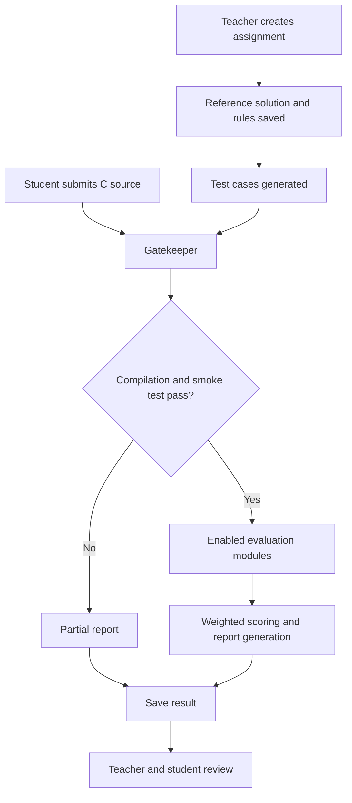

# C-Grade Engine

**An automated, multi-dimensional assessment and profiling framework for C programming assignments.**

C-Grade Engine helps instructors evaluate C programs using a collection of specialist analyzers. It checks whether a submission compiles and runs, compares its output with reference-generated tests, checks for memory and code-quality issues, and produces a detailed assessment report.

The project is used through a web portal: teachers create assignments and manage students, while students submit C source files and view their evaluation results.

**GitHub repository:** [https://github.com/manasg423/c-grade](https://github.com/manasg423/c-grade)

---

## Table of Contents

- [Key Features](#key-features)
- [How the System Works](#how-the-system-works)
- [Evaluation Modules](#evaluation-modules)
- [Technology Stack](#technology-stack)
- [Project Structure](#project-structure)
- [Installation on a Fresh Ubuntu/Linux System](#installation-on-a-fresh-ubuntulinux-system)
- [First-Time Setup](#first-time-setup)
- [Using the Web Portal](#using-the-web-portal)
- [Where Files and Reports Are Stored](#where-files-and-reports-are-stored)
- [Testing and Troubleshooting](#testing-and-troubleshooting)
- [Limitations and Security Notes](#limitations-and-security-notes)
- [Future Scope](#future-scope)
- [Contributing](#contributing)
- [License](#license)
- [Acknowledgements](#acknowledgements)

---

## Key Features

- **Automated grading:** Evaluates C submissions using configurable, weighted metrics.
- **Correctness testing:** Runs student programs against test cases and compares their output with expected output.
- **Automatic test generation:** Uses a teacher-provided reference program (`oracle.c`) and a local Ollama model to generate additional test inputs.
- **Edge-case testing:** Checks selected boundary and unusual inputs.
- **Runtime and memory checks:** Uses compiler and sanitizer-based checks to identify certain memory-safety and runtime problems.
- **Static code analysis:** Uses GCC diagnostics and Cppcheck to identify potential problems in source code.
- **Code-quality checks:** Examines modularity, function structure, formatting, and readability.
- **Similarity analysis:** Compares submissions with other available submissions in the assignment corpus.
- **Detailed reports:** Produces an overall grade, per-metric scores, evidence, and feedback.
- **Teacher and student portals:** Supports assignment setup, student roster management, code submission, and result review.
- **Local-first operation:** Core grading runs on the machine hosting the project. Ollama can provide local AI-assisted functionality without sending source code to a hosted LLM API.

## How the System Works

A typical portal-based assessment follows this process:

1. A teacher signs in and imports the student roster.
2. The teacher creates an assignment, provides its description and reference C solution, selects evaluation modules, and configures limits.
3. C-Grade saves the assignment rules and reference solution, then attempts to generate test cases.
4. A student signs in and submits a `.c` file.
5. The Gatekeeper validates the assignment rules, checks basic source requirements, compiles the program, and performs a smoke test.
6. If compilation succeeds, the enabled analyzers evaluate the submission. Execution-based analyzers are skipped if the smoke test fails.
7. The reporter combines the results into an overall grade and detailed feedback.
8. The result is saved in the local SQLite database and made available in the relevant portal views.

### High-level workflow




## Evaluation Modules

The project contains nine specialist analyzers. The teacher can enable or disable them while creating an assignment; the selected metric weights are normalized to a total of 100%.

| Module | What it checks |
|---|---|
| `io_tests` | Runs the submission against available input/output test pairs. |
| `edge_case_runner` | Runs additional boundary and unusual test inputs. |
| `sanitizer_run` | Uses compiler sanitizers to look for supported runtime memory errors and undefined behaviour. |
| `complexity_estimator` | Profiles program execution using Valgrind Callgrind instruction counts and evaluates the observed growth pattern. |
| `static_analysis` | Uses Cppcheck, GCC diagnostics, and source-format checks to identify potential issues. |
| `compiler_warnings` | Collects compiler diagnostics and evaluates warnings. |
| `function_split` | Examines function structure and code modularity. |
| `similarity_flag` | Compares normalized code fingerprints against available submissions. |
| `llm_review` | Reviews code readability with a local Ollama model, with a heuristic fallback when the model is unavailable. |

Not every analyzer is guaranteed to produce a conclusive result for every program. The report includes evidence and feedback so that a teacher can inspect the outcome instead of relying only on the final score.

## Technology Stack

| Area | Technologies |
|---|---|
| Main languages | C, Python |
| Web interface | Streamlit |
| C compilation | GCC |
| Static analysis | Cppcheck, GCC diagnostics, Lizard |
| Runtime profiling | Valgrind / Callgrind |
| AI-assisted features | Ollama with `qwen3.5:2b` by default |
| Database | SQLite |
| Report generation | JSON, text, and PDF support through ReportLab |
| Python environment | `venv` and `pip` |

## Project Structure

```text
c-grade-main/
├── analyzers/                 # Specialist evaluation modules
│   ├── compiler_warnings.py
│   ├── complexity_estimator.py
│   ├── complexity_fitting.py
│   ├── edge_case_runner.py
│   ├── function_split.py
│   ├── input_spec.py
│   ├── io_tests.py
│   ├── llm_review.py
│   ├── sanitizer_run.py
│   ├── similarity_flag.py
│   └── static_analysis.py
│
├── core/                      # Grading pipeline, sandbox and reporting
│   ├── first_pass.py
│   ├── pdf_reports.py
│   ├── portal_rules.py
│   ├── reporter.py
│   └── sandbox.py
│
├── database/                  # SQLite database and authentication
│   ├── auth.py
│   └── database.py
│
├── resources/                 # Setup and implementation reference documents
├── testing/                   # Development and analyzer testing utilities
├── app.py                     # Streamlit teacher/student portal
├── test_case_generator.py     # Reference-based test-case generation
├── requirements.txt           # Python dependencies
└── README.md
```

The `problems/`, `portal.db`, and report/test directories are created or populated while the application is used. They are runtime data and are intentionally excluded from the source repository by `.gitignore`.

---

## Installation on a Fresh Ubuntu/Linux System

These instructions start with a fresh Ubuntu installation. You do not need to have Python, GCC, Git, or any C analysis tools installed beforehand.

> **Recommended environment:** Ubuntu 22.04 or 24.04. The project uses Linux/POSIX process limits and Valgrind Callgrind for its strict profiling path. Other Linux distributions may use different package-manager commands.

### Step 1 — Open the Terminal

1. Start your Ubuntu computer.
2. Press **Ctrl + Alt + T** to open the Terminal.
3. Keep this Terminal open while following the instructions.

### Step 2 — Update Ubuntu

Copy this command into the Terminal and press Enter:

```bash
sudo apt update
```

If Ubuntu asks for your password, type your Linux account password and press Enter. The password will not appear on the screen while you type; this is normal.

### Step 3 — Install the required Linux tools

Copy and run:

```bash
sudo apt install -y git python3 python3-venv python3-full python3-pip build-essential gcc cppcheck valgrind
```

This installs:

- **Git:** downloads the project from GitHub.
- **Python 3:** runs the application and analyzers.
- **venv and pip:** create an isolated Python environment and install Python packages.
- **GCC and build tools:** compile C programs.
- **Cppcheck:** checks C source code for potential problems.
- **Valgrind:** provides Callgrind profiling and memory-analysis tools.

Check that the tools are available:

```bash
git --version
python3 --version
gcc --version
cppcheck --version
valgrind --version
```

Each command should print a version. If a command is not found, repeat the installation command above and check the error shown by Ubuntu.

### Step 4 — Download C-Grade Engine

Download the project from its GitHub repository by running:

```bash
git clone https://github.com/manasg423/c-grade.git
```

After cloning, enter the downloaded project folder:

```bash
cd c-grade
```

Check that you are in the correct place:

```bash
ls
```

You should see files and folders including `app.py`, `agent.py`, `analyzers`, `core`, `database`, and `requirements.txt`.

**If you downloaded a ZIP instead of using Git:** open the Downloads folder, extract the ZIP, open a Terminal in the extracted project folder (for example, `c-grade-main`), and continue from this step.

### Step 5 — Create a separate Python environment

Run these commands from inside the project folder:

```bash
python3 -m venv .venv
source .venv/bin/activate
```

After activation, your Terminal prompt will usually begin with `(.venv)`.

Check that Python is coming from the new environment:

```bash
which python
python --version
```

The path printed by `which python` should end with `.venv/bin/python`.

> Every time you close the Terminal and open a new one, return to the project folder and run `source .venv/bin/activate` before starting the application or installing packages.

### Step 6 — Install the Python packages

Make sure the virtual environment is active. Then run:

```bash
python -m pip install --upgrade pip
python -m pip install -r requirements.txt
```

Wait for the installation to finish. This installs Streamlit and the Python libraries used by the project.

Do not use `sudo pip install` or `--break-system-packages`. The project uses its own `.venv` environment so that it does not modify Ubuntu's system Python packages.

### Step 7 — Install Ollama for automatic test generation (recommended)

C-Grade uses a local Ollama model to generate test inputs from the teacher's reference C solution. The readability analyzer can use a heuristic fallback, but automatic test generation depends on the local Ollama service and configured model.

Install Ollama by following its official Linux instructions:

<https://ollama.com/download/linux>

After installation, open a Terminal and check:

```bash
ollama --version
```

Download the model used by the current project configuration:

```bash
ollama pull qwen3.5:2b
```

This model download may take some time. When it finishes, check that it is installed:

```bash
ollama list
```

You should see `qwen3.5:2b` in the list. Ollama normally runs as a background service on Linux. If it is not running, start it in a separate Terminal with:

```bash
ollama serve
```

Keep that Terminal open if you started the service manually. If Ollama says that the port is already in use, the service may already be running; check it with `ollama list` in another Terminal.

### Step 8 — Configure the teacher login

The teacher login is read from a `.env` file in the main project folder. Create it with:

```bash
nano .env
```

Add these two lines, replacing the example values with your own username and a strong password:

```dotenv
TEACHER_USERNAME=teacher
TEACHER_PASSWORD=replace_this_with_a_strong_password
```

Save the file in Nano:

1. Press **Ctrl + O**.
2. Press **Enter** to confirm the filename.
3. Press **Ctrl + X** to exit.

The `.env` file is ignored by Git, so your local teacher password should not be committed to the repository. Do not share it publicly.

### Step 9 — Start C-Grade Engine

Make sure you are in the project folder and the Python environment is active. Run:

```bash
python -m streamlit run app.py
```

After a few seconds, Streamlit will print a local address. Open your web browser and visit:

```text
http://localhost:8501
```

You should now see the C-Grade login page.

To stop the application, return to the Terminal where it is running and press **Ctrl + C**.

---

## First-Time Setup

Complete these steps after the portal opens for the first time.

### 1. Sign in as a teacher

- Select **Teacher** on the login page.
- Enter the username and password you added to `.env`.
- Click **Sign in**.

If teacher login is unavailable, check that `.env` is in the same folder as `app.py`, that both variable names are spelled exactly as shown, and that you restarted Streamlit after creating or changing the file.

### 2. Import the student list

The teacher needs to add students before they can sign in.

1. Open **Students** from the sidebar.
2. Prepare a CSV file with two columns named `roll_no` and `name`.
3. Add one student per row.
4. Upload the CSV and click **Import roster**.

Example CSV:

```csv
roll_no,name
2026001,Alex Kumar
2026002,Sam Patel
2026003,Jamie Das
```

New student accounts are initially assigned the password `123`. Tell each student to sign in with their roll number and this initial password, then change it from **Settings**. Do not use real student data in a public demo.

### 3. Create the first assignment

1. Open **Assignments** in the teacher sidebar.
2. Select the **New assignment** tab.
3. Enter an assignment title, for example `Array Sum`.
4. Enter a problem slug, for example `array-sum`. Use lowercase letters, numbers, hyphens, or underscores, with no spaces.
5. Choose a due date.
6. Set the time limit and memory limit.
7. Enter a sample input that your reference program can read. This is used for the initial smoke/sanitizer checks.
8. Choose the input type and expected complexity used by the relevant evaluation configuration.
9. Choose how many automatic I/O tests to generate.
10. Upload the teacher's correct C solution (`.c`) or paste it into the reference-code box.
11. Select the analyzers you want to use.
12. Click **Save and deploy assignment**.

C-Grade saves the assignment, reference solution, and grading rules. It then attempts to generate I/O and edge test cases. For automatic generation, make sure Ollama is running and the `qwen3.5:2b` model is installed.

### 4. Let a student submit code

1. Sign out of the teacher account.
2. Select **Student** on the login page.
3. Enter the student's roll number and initial password (`123`, unless it has already been changed).
4. Open **Submit code**.
5. Select the assignment.
6. Upload a `.c` file or paste the C program into the text box.
7. Click **Submit code once**.

The student can view the evaluation result in the portal. The current portal allows one submission per student per assignment; resubmission is disabled after the submission is recorded. Make sure the correct file is selected before submitting.

### 5. Review the result as a teacher

Sign back in as a teacher, open **Grading**, and select the assignment. The teacher can review submissions, scores, analyzer results, and available evidence.

---

## Using C-Grade Engine

C-Grade Engine is operated through its web portal. The web portal is where teachers configure assignments and review grading, and where students submit their programs and view released results.

### Teacher actions

| Portal section | What you can do |
|---|---|
| Overview | View student, assignment, and submission counts. |
| Students | Import, view, edit, and delete student records. |
| Assignments | Create assignments and inspect or edit assignment materials. |
| Grading | Review submissions, grades, analyzer evidence, and feedback. |

### Student actions

| Portal section | What you can do |
|---|---|
| Assignments | View available assignments, deadlines, submission status, and released results. |
| Submit code | Upload a C file or paste source code for an assignment. |
| Settings | Change the student password. |

### Starting the portal on a later day

Whenever you want to use C-Grade again:

1. Open Terminal.
2. Move into the project folder. For example:

   ```bash
   cd ~/c-grade-main
   ```

   If you extracted or cloned it somewhere else, use that folder's actual path.
3. Activate the Python environment:

   ```bash
   source .venv/bin/activate
   ```
4. Make sure Ollama is running if you need AI-assisted test generation or review.
5. Start the portal:

   ```bash
   python -m streamlit run app.py
   ```
6. Open `http://localhost:8501` in your browser.

To shut it down, go to the Streamlit Terminal and press **Ctrl + C**.

---

## Where Files and Reports Are Stored

The application creates and maintains runtime files in the project directory:

| Path | Contents |
|---|---|
| `portal.db` | SQLite database containing student, assignment, submission, and report records. |
| `problems/<problem-slug>/` | Files belonging to an assignment. |
| `problems/<problem-slug>/tests/oracle.c` | Teacher's reference C solution. |
| `problems/<problem-slug>/tests/` | Generated and manually maintained test cases. |
| `problems/<problem-slug>/submissions/` | Student source files used by the grading workflow. |
| `problems/<problem-slug>/reports/` | Reports and assessment artifacts generated by the grading workflow. |
| `.env` | Local teacher login configuration. |
| `.venv/` | Project-specific Python environment. |

Keep backups of `portal.db` and the `problems/` directory if you need to preserve course data, submissions, or generated tests. Do not commit private student records, passwords, or submissions to a public repository.

## Testing and Troubleshooting

### Check that the Python environment is active

```bash
source .venv/bin/activate
which python
```

The Python path should contain `.venv/bin/python`.

### Python says a module is missing

Activate the environment and reinstall the project dependencies:

```bash
source .venv/bin/activate
python -m pip install -r requirements.txt
```

### Ubuntu says `externally-managed-environment`

This usually means you are using the system Python instead of the project's virtual environment. Activate `.venv` and use `python -m pip`, not `sudo pip`.

### GCC or Cppcheck is not found

```bash
sudo apt update
sudo apt install -y build-essential gcc cppcheck
```

### Valgrind or Callgrind profiling is unavailable

```bash
sudo apt install -y valgrind
valgrind --version
```

The complexity analyzer also checks for the Callgrind development header at `/usr/include/valgrind/callgrind.h`. If the header is missing, install the Ubuntu package that provides Valgrind development files for your release. The estimator should report an inconclusive result if strict instruction profiling cannot be performed; it should not be interpreted as a measured complexity result.

### Ollama connection error or model not found

Check that Ollama is installed and the model is available:

```bash
ollama --version
ollama list
```

If the model is missing, download it:

```bash
ollama pull qwen3.5:2b
```

If the service is not running, start it in another Terminal:

```bash
ollama serve
```

### The browser cannot open the portal

- Check that the Terminal running Streamlit has not been closed.
- Check the URL printed by Streamlit. The default is `http://localhost:8501`.
- If port 8501 is already in use, start the app on another port:

  ```bash
  python -m streamlit run app.py --server.port 8502
  ```

  Then open `http://localhost:8502`.

### Teacher login does not work

- Confirm `.env` is in the same directory as `app.py`.
- Confirm it contains `TEACHER_USERNAME` and `TEACHER_PASSWORD`.
- Check for spelling mistakes or accidental spaces around the values.
- Stop Streamlit with **Ctrl + C**, then start it again.

### An assignment was created but no generated tests appeared

- Confirm Ollama is running.
- Confirm `qwen3.5:2b` appears in `ollama list`.
- Check that the reference C program compiles and works with the sample input.
- Read the message shown by the portal after assignment deployment and inspect the Terminal output.

### Save an error message for troubleshooting

When asking for help, include the full error message and the output of these commands:

```bash
python --version
which python
gcc --version
cppcheck --version
valgrind --version
ollama list
```

## Limitations and Security Notes

- Passing a finite set of test cases does not prove that a program is correct for every possible input.
- **The default AI model is small:** C-Grade currently uses `qwen3.5:2b`, a relatively lightweight model chosen to run locally on modest hardware. It has limited reasoning and code-understanding capacity compared with larger models. It can misunderstand a problem statement or reference implementation, infer the wrong input format, generate malformed or invalid test inputs, miss important boundary cases, or produce tests that do not cover the intended behaviour. The model may also give incomplete or inaccurate readability feedback. A successful model response does not guarantee that its output is correct.
- **Generated tests are not a proof of correctness:** Test generation depends on the teacher's problem description, sample input, and reference implementation as well as the model's output. If the reference solution itself contains a bug, generated expected outputs can reproduce that bug. Automatically generated tests may be redundant, invalid, too easy, or miss important cases. Teachers should inspect and validate generated tests, add their own tests, and avoid treating a passing test suite as proof that a submission is correct.
- **Complexity estimates are experimental, not mathematical proofs:** The complexity analyzer measures instruction counts for selected input sizes and fits candidate growth models to the observed data. Its conclusion depends on correctly identifying the input dimensions, generating representative inputs, isolating the relevant computation, obtaining enough successful profiling runs, and having suitable candidate models. Small input ranges, unusual input formats, recursion, library routines, compiler behaviour, and profiling limitations can make different complexity classes look similar. In particular, an estimated `O(N)` or `O(N log N)` result should be treated as an informed estimate, not a guarantee. Results may be inconclusive or misclassified; verify them against the algorithm and independent benchmarks.
- **No single analyzer is definitive:** Static analysis, sanitizers, similarity detection, heuristic checks, and AI feedback each have blind spots. Treat their findings as evidence to support instructor review, not as unquestionable verdicts.
- Similarity analysis is a signal for human review, not proof of plagiarism. Refactoring can change similarity results, and unrelated programs may share common code patterns.
- AI-assisted readability feedback may vary with model versions and local configuration. The heuristic fallback is more limited than a full language-model review.
- The execution sandbox applies process time and memory limits, but it is not a hardened container or virtual machine. Do not expose this application to untrusted users on a public server without additional isolation, authentication, and security controls.
- The current student portal permits one submission per student per assignment and disables resubmission after a submission is recorded.
- The initial student password is `123`. Students should change it immediately after their first login. Use a strong teacher password and protect the host machine and its database.

## Future Scope

Potential areas for future development include:

- Stronger process isolation for untrusted C programs.
- More comprehensive test generation and test-suite validation.
- Expanded language and compiler support.
- Improved analyzer calibration and benchmark-based validation.
- More detailed instructor analytics and configurable report formats.
- Fine-grained user roles and administrative controls.

## Contributing

Contributions, bug reports, and suggestions are welcome.

1. Fork the repository.
2. Create a branch for your change.
3. Make the change and test it on Linux.
4. Explain the change and include relevant test cases or reproduction steps.
5. Open a pull request.

For bug reports, include your Linux distribution, Python version, compiler/tool versions, the command you ran, and the complete error message. Remove student-identifying information and passwords before sharing logs.

## License

No license file is currently included in this repository. Until a license is added, assume that normal copyright restrictions apply; do not assume the code is available for unrestricted reuse, modification, or redistribution.

## Acknowledgements

C-Grade Engine is built with the support of the open-source tools and libraries listed in the Technology Stack section, including Python, Streamlit, GCC, Cppcheck, Valgrind, Lizard, SQLite, ReportLab, and Ollama.
